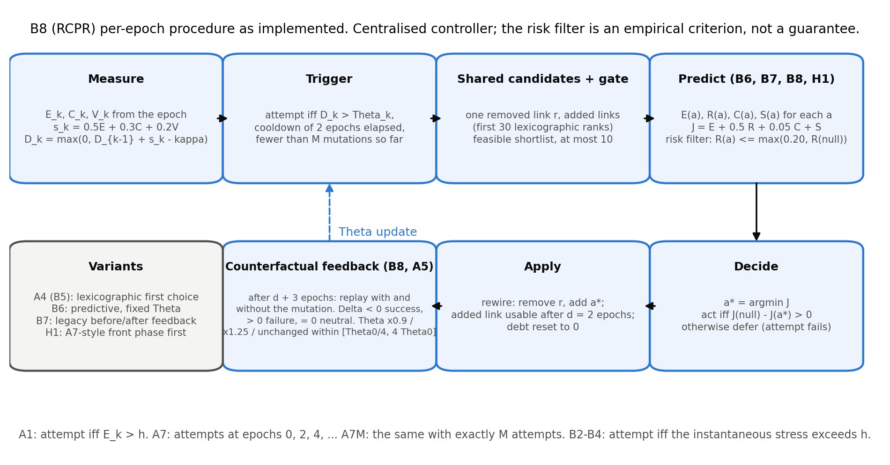
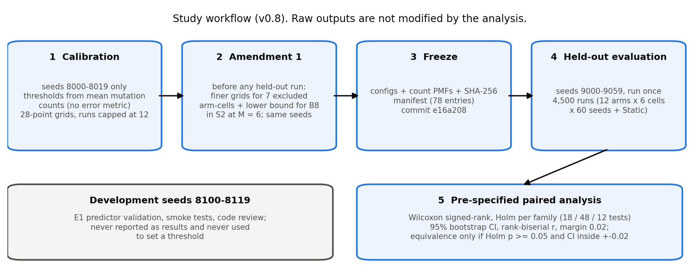
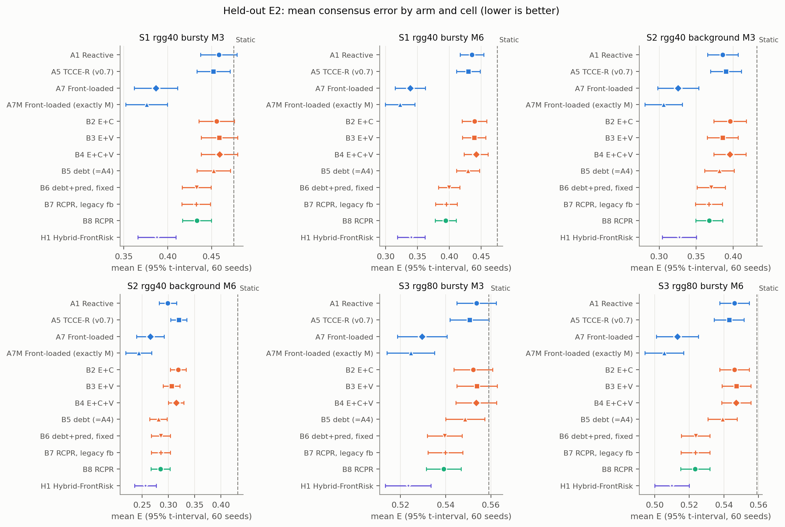
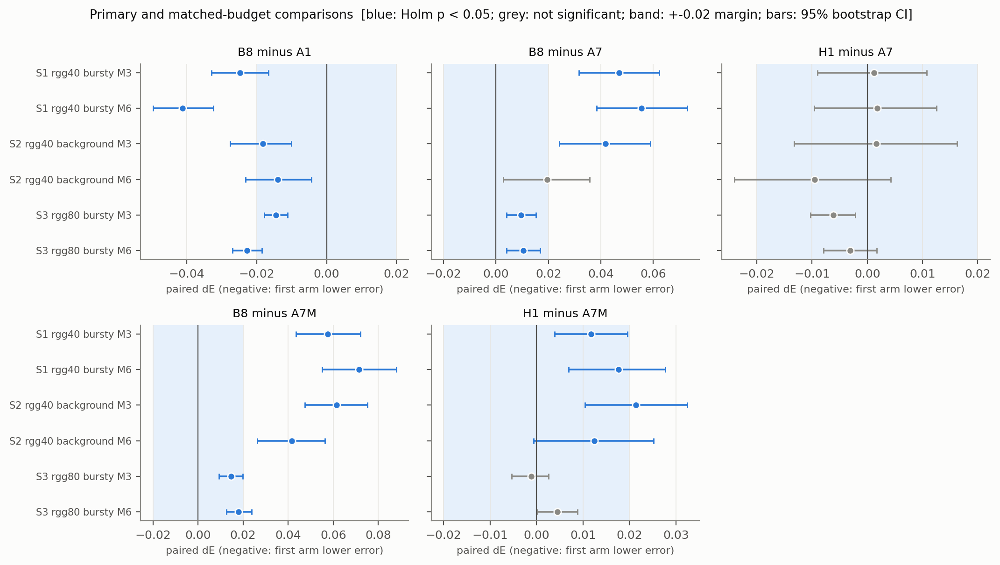
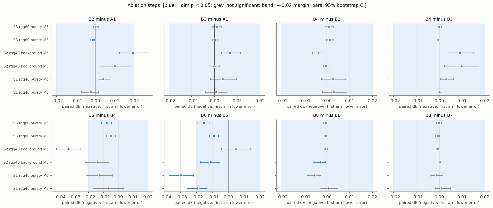
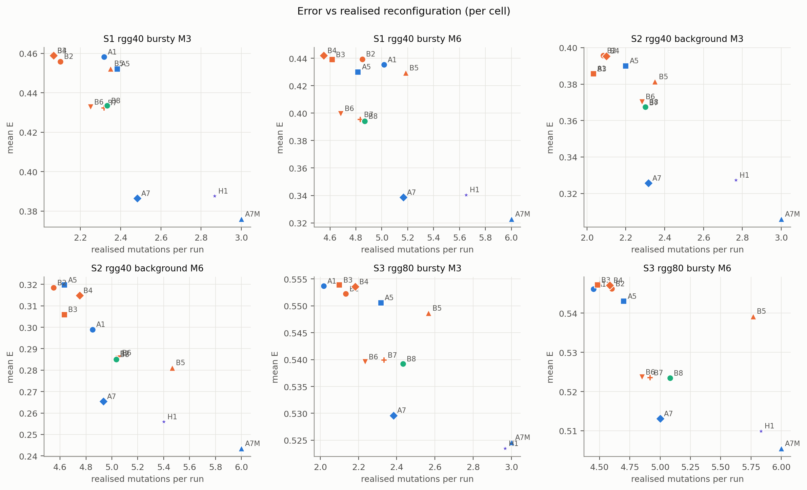
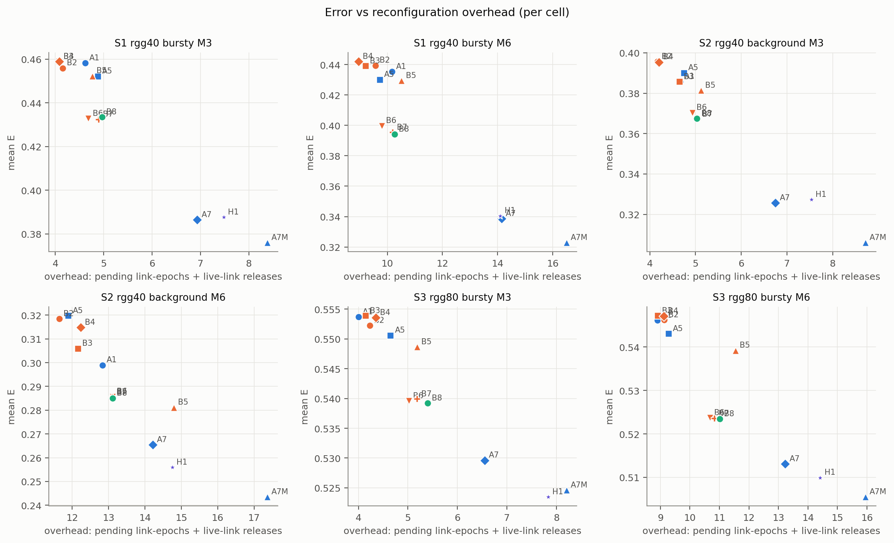
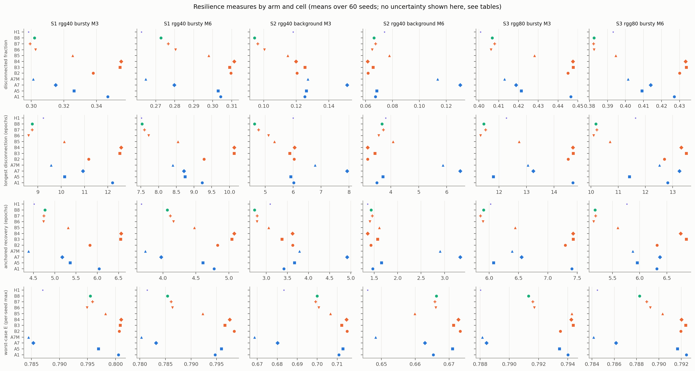
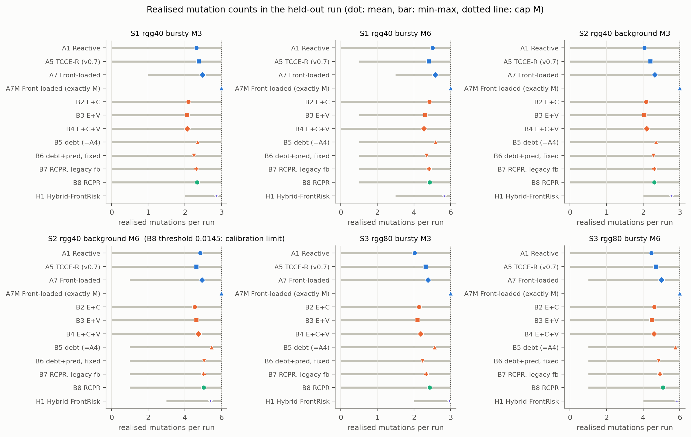

**Highlights**

- Budget-constrained comparison of reactive, front-loaded and predictive rewiring
- Predictive controller had lower error than reactive rewiring in all six conditions
- Front-loaded timing had lower error than predictive control in all point estimates
- Adaptive thresholds and counterfactual feedback showed no measurable benefit
- Calibration limits, seeds and scripts are documented for audit

[[PAGEBREAK]]

# When Does Resilience-Aware Topology Adaptation Help Consensus? A Budget-Constrained Comparison of Reactive, Front-Loaded and Predictive Rewiring

**[Author 1 — to be completed]¹, [Author 2 — to be completed]²∗**

¹[Affiliation 1 — to be completed]

²[Affiliation 2 — to be completed]

∗Corresponding author: [name and e-mail — to be completed]

> Draft note (remove before submission): revised manuscript (v0.8). Every result-dependent number in the Abstract, Results, Tables and Discussion is generated from `revision/analysis/E2/` (held-out evaluation, seeds 9000–9059) or `results/v0.8/E1/` (development seeds) by `paper/tools/build_manuscript_v08.py`; the qualitative claims are asserted against those files by `paper/tools/check_claims_v08.py`. Items that could not be verified are marked **[UNRESOLVED]**. The previous (v0.7) manuscript is preserved unchanged in `paper/manuscript.md`. Author, affiliation, funding, interest and contribution details are placeholders.


## Abstract

Networks that rewire links to survive failures can keep distributed consensus working, but it is unclear when resilience-aware rewiring is worth its complexity compared with simple reactive or timing-based rules. We ask when a controller that accumulates a "resilience debt" and selects rewirings by a predictive, risk-filtered score reduces consensus error under a fixed rewiring budget, relative to a reactive threshold (A1) and to front-loaded schedules (A7, A7M). Random geometric networks (40 and 80 nodes) with transient, background and burst failures and budgets of 3 and 6 rewirings give six conditions. Thresholds were calibrated on separate seeds from mutation counts, frozen, and evaluated once on 60 held-out seeds (4,500 runs); paired comparisons use Wilcoxon tests, Holm correction, bootstrap intervals and a 0.02 practical margin. The predictive controller B8 had lower error than A1 in all six conditions (ΔE {{rng:primary|B8-A1|mean_diff|3}}; Holm p ≤ {{v:primary|S2M6|B8-A1|holm_p|3}}), beyond the margin in {{cnt:primary|B8-A1|first arm meaningfully better}} of them. A7 had lower error than B8 in all six point estimates (Holm-significant in five; inconclusive in S2, M = 6), A7M in all six, and a front-loaded-then-adaptive hybrid was not distinguishable from A7. Bridge and volatility signals did not improve on A1; adaptive thresholds and counterfactual feedback showed no measurable benefit. A predictive selector is consistent with B8's gain over A1, but a development-seed validation found little selector headroom, a discrepancy left unresolved. We offer a framework and evaluation with explicit calibration limits (notably S2, M = 6), not a superiority claim.

**Keywords:** distributed consensus; topology adaptation; link rewiring; network resilience; budget-constrained control; negative results

## 1. Introduction

Distributed averaging and consensus let nodes agree on a common value using local exchanges, and their convergence speed depends on the connectivity of the communication graph, in particular its algebraic connectivity λ₂ {{R:Fiedler1973;XiaoBoyd2004;OlfatiSaberMurray2004}}. When links fail, are repaired, or are lost in correlated bursts, the effective graph changes and consensus degrades. A large literature designs the consensus law itself to tolerate such conditions, through adaptive and event-triggered protocols {{R:Zhang2023;Xiao2022;Wang2023}} and through protocols analysed under switching topologies and random link failures {{R:Battilotti2024;Liu2024;Fu2026}}. A complementary line changes the *topology*: connectivity-aware reconfiguration, rewiring and robustness-oriented topology design {{R:Muthirayan2022;Chujyo2024;Feng2024;Estrada2026}}.

This paper concerns the second line under an explicit constraint that is often implicit in practice: only a small number M of rewirings may be spent per run. The question is then not only *which* link to add or remove but *when* to spend each rewiring. TCCE-R (Topology–Consensus Co-Evolution with Resilience debt) was designed on the intuition that a controller aware of how much consensus-error stress has accumulated, how fragile the graph is (bridge fraction) and how volatile the links are, should decide when and where to rewire better than one reacting to an instantaneous error. An earlier, pre-registered evaluation (v0.7) did not support this intuition for the original design: it was practically equivalent to a reactive threshold and worse than a state-blind front-loaded schedule. This revision asks a more specific question: **when, if ever, does resilience-aware adaptation help, and which of its components is responsible?**

**Research gap and positioning.** In the literature we reviewed (a non-systematic review, `docs/LITERATURE_REVIEW.md`), consensus work mostly designs the control law for a given or switching topology, and reconfiguration work mostly designs *where* to add links; we found few controlled comparisons of *rewiring timing* under a matched mutation budget against simple state-blind baselines. The individual ingredients we use are established: CUSUM statistics {{R:Page1954}} (including on network structure {{R:Zhang2023b}}), bridge detection, algebraic connectivity and its first-order gain estimate {{R:Fiedler1973;GhoshBoyd2006}}, hazard-based failure estimates and counterfactual replay. We do **not** claim novelty for any of them. Whatever novelty exists lies in their integration in a budget-constrained controller, in the resilience-debt formulation, and above all in the systematic evaluation, including baselines that expose the importance of timing.

**Research questions.**
- **RQ1.** Does the predictive controller B8 reduce consensus error relative to a reactive threshold (A1)?
- **RQ2.** Does B8, or a hybrid that front-loads then adapts (H1), match or beat a front-loaded schedule (A7, A7M)?
- **RQ3.** Which components (extra signals, accumulation, predictive selection, adaptive threshold, counterfactual feedback) are associated with changes in error?
- **RQ4.** What trade-offs appear among consensus error, disconnection and recovery, and reconfiguration overhead?

**Contributions.** (i) A fully specified, reproducible protocol with separate calibration, development and held-out seed ranges, a frozen calibration and a single held-out evaluation. (ii) A controlled comparison of twelve arms that share the candidate generator, safety gate and edge budget, including front-loaded baselines (A7, A7M) and one-component-at-a-time ablations. (iii) A predictive, risk-filtered selector (B8) whose objective follows the form J = αE + βR + γC + δS (no uncertainty term, because uncertainty is not modelled) and an honest account of what it does and does not achieve. (iv) A report of negative and mixed results with the diagnostics, calibration limitations and scripts needed to audit them. These are a framework and an evaluation, not a proven algorithmic advance.

## 2. Literature Survey

**Adaptive and event-triggered consensus.** Recent work proposes adaptive, dynamic and predefined-time event-triggered consensus protocols for nonlinear, fractional-order, fault-prone and attacked multi-agent systems, often under switching topologies {{R:Zhang2023;Xiao2022;Wang2023;PerezSalesa2023;Kim2023;Wang2024;Dong2026;Tian2022}}. Our controller differs in what it triggers: it triggers *topology mutations* rather than state communication or control updates, and its trigger (a CUSUM on a stress signal) is a different object from the event-triggered communication rules studied in those works.

**Time-varying topology and link failures.** Consensus, flocking and distributed-optimisation algorithms have been studied under random link failures, random subgraphs, time-varying topologies and adversarial behaviour {{R:Battilotti2024;Liu2024;Li2024;Yan2024;Fu2026;Gao2024}}; predictive control has been applied to consensus in switching networks {{R:Han2025}}. Our failures are benign (transient outages, background on–off failures, spatially correlated bursts), nodes are honest, and we do not modify the consensus law, which is Metropolis-weight averaging {{R:XiaoBoyd2004}}.

**Connectivity-aware topology control and rewiring.** Recent work addresses connectivity preservation, restoration and robustness through edge addition, rewiring or reconfiguration, with algebraic-connectivity, k-connectivity or model-predictive formulations, in multi-robot, multi-vehicle and complex-network settings {{R:Muthirayan2022;Chujyo2024;Wang2023b;Shan2025;Feng2024;Shi2025;Shetty2023;ElHamamsy2023;Du2025;Estrada2026}}. The first-order gain in λ₂ from adding a link is classical {{R:GhoshBoyd2006}} and is what our shared candidate ranking uses.

**Resilience and recovery.** Resilience has been studied in communication and power-distribution settings through reconfiguration after disasters, self-healing, recovery models and augmentation against geographically correlated failures {{R:Imteaj2023;Jo2024;Jimenez2023;AndresThio2022;Li2022;Awoyemi2022;Hafaiedh2022}}. Our burst model is of the kind used to represent geographically correlated failures, which several of these works study; our recovery measures (longest disconnection, anchored recovery time) are simple descriptive statistics, not an optimisation target.

**Predictive and counterfactual control.** Model-predictive control has been used for connectivity preservation {{R:ElHamamsy2023;Du2025}}, learning-based methods for link prediction and topology optimisation {{R:Mei2024;Tang2025;Binh2026}}, and CUSUM-type statistics for detecting changes in network structure {{R:Zhang2023b}}. Our predictor is deliberately simple: a hazard-based, expected-Metropolis surrogate with a union-bound risk proxy (Section 4.5), not a learned model; our counterfactual feedback is a model-based replay inside the simulator and requires an exact model of the consensus dynamics. We do not compare with learned or model-predictive controllers.

**Mutation-budget constraints.** Link-limited rewiring and online robustness under connectivity constraints {{R:Chujyo2024;Muthirayan2022}} are related to our per-run cap M and strict edge budget; our setting adds a setup delay and failures during operation.

**Statistical methodology.** Paired nonparametric testing {{R:Wilcoxon1945}}, Holm's sequentially rejective correction {{R:Holm1979}}, the bootstrap {{R:Efron1979}} and equivalence reasoning with a smallest effect size of interest {{R:Lakens2017}} underlie the analysis. Citations in this section are supported at the level of titles and bibliographic metadata verified against Crossref (abstracts and full texts were not read for this revision); we have not re-derived any cited result (`revision/literature/LITERATURE_AUDIT_v08.md`).

## 3. System Model

**Network and failures.** A network has n nodes in the unit square (n = 40 or 80) and a set of *candidate* links between node pairs within radio range; a subset is *configured* initially (links within an initial radius). Time is divided into epochs k = 0,…,79 of T = 60 consensus rounds. A configured link is *live* in an epoch if it is not failed and not in setup. Three failure processes act: (a) transient outages (each configured link unusable in each round independently with probability 0.05); (b) background on–off failures per epoch (fail probability p_fail, repair probability 0.1); (c) spatially correlated bursts (S1, S3): a burst starts with probability 0.1 per epoch, and fails every potential link whose midpoint lies within radius 0.15 of a uniformly random centre for 2–6 epochs. S2 has no bursts and a higher background failure rate. A new link becomes usable after a setup delay of d = 2 epochs; a removed link disappears immediately.

**Consensus error.** At the start of every epoch each node draws fresh initial values x(0). Over T rounds nodes apply Metropolis averaging on the live graph of the round: for live neighbours i, j, W_ij = 1/(1 + max(d_i, d_j)), W_ii = 1 − Σ_j W_ij. With x̄ the mean of x(0),

$$e(t)=\frac{\lVert x(t)-\bar x\mathbf 1\rVert}{\lVert x(0)-\bar x\mathbf 1\rVert},\qquad E_k = 1-\min\Bigl(1,\max\Bigl(0,\frac{\ln e_k(T)}{\ln\varepsilon}\Bigr)\Bigr),\quad \varepsilon=0.01 .\tag{1}$$

In Eq. (1), E_k ∈ [0, 1] (0: the error fell to ε or below within the epoch; 1: no progress). **Lower E is better.** The primary outcome of a run is the mean of E_k over its 80 epochs.

**Control problem.** A logically centralised controller observes the graph and the history of E_k, C_k and V_k and may *mutate* the topology at most once per epoch and at most M times per run. Every mutation is a *rewire*: it removes one configured link and adds one candidate link (strict edge budget). The question is *when* to attempt a mutation and, for some arms, *which* candidate to choose; the candidate generator and the safety gate are identical across arms.

**Scope.** The controller is centralised (global graph information, exact-model counterfactual replay). Node load, traffic, trust and adversarial attacks are not modelled. The simulator contains options for non-geometric graphs, an abrupt-outage shock and controller-side observation noise or delay, but **none of them is used in any experiment reported here**, and they would perturb only the controller's trigger statistics, not its feedback, candidate scoring or safety gate (`revision/audit/V08_CODE_REVIEW.md`). No claim about distributed operation, partial observation or other graph families is made.

## 4. Mathematical Formulation and Method

### 4.1. Signals, stress and resilience debt

Let L_k be the live links and Q_k the configured links in epoch k. The three measured signals are the consensus error E_k (Section 3), the structural fragility C_k = 1 if the live graph is disconnected, otherwise C_k = (number of bridges)/|L_k|, and the link volatility V_k = min(1, F_k/|Q_k|), where F_k is the number of up/down changes of configured links over the epochs k−2, k−1 and k (own mutations excluded). All three lie in [0, 1]. The stress is s_k = w_E E_k + w_C C_k + w_V V_k with weights ≥ 0 fixed in code: A3 uses (1, 0, 0); the arms with the full stress (A4, A5, B5–B8, H1) use (0.5, 0.3, 0.2), which sum to one; no weight tuning was performed. The **resilience debt** is Page's one-sided CUSUM {{R:Page1954}},

$$D_k=\max\bigl(0,\ D_{k-1}+s_k-\kappa\bigr),\qquad D_{-1}=0,\tag{2}$$

with reference value κ ≥ 0 in Eq. (2) equal to the median of the corresponding stress over connected epochs of the static arm A0 on calibration seeds (the κ values are listed in Appendix B). The debt is reset to 0 only after a successful mutation (exception: phase 1 of H1, Section 4.6). It is unbounded above while the controller cannot act.

### 4.2. Trigger and adaptive threshold

A mutation is attempted when D_k > Θ_k, at least 2 epochs have passed since the last successful mutation, and fewer than M mutations have been made. For A5, B7, B8 and H1 the threshold adapts within [Θ₀/4, 4Θ₀]: Θ ← 0.9Θ after a successful mutation, Θ ← 1.25Θ after a failed one, unchanged if neutral (factors hard-coded). B5, B6 use a fixed Θ = Θ₀. The instantaneous arms (A1, B2–B4) attempt when the instantaneous statistic exceeds a fixed h (E for A1; (0.5E + 0.3C)/0.8, (0.5E + 0.2V)/0.7 and 0.5E + 0.3C + 0.2V for B2, B3, B4).

### 4.3. Counterfactual and legacy feedback

For a mutation at epoch m, the **counterfactual** rule replays the window {m + 1,…,m + d + H} (d = 2, H = 3) from the pre-mutation snapshot with and without the mutation under the identical observed failures, outages and initial values; with Δ the mean E with minus the mean E without, the outcome is success if Δ < 0, failure if Δ > 0 and neutral (no update) if Δ = 0. Each mutation is replayed alone and no future information is used. The replay assumes an exact model of the consensus dynamics. The **legacy** before/after rule (B7) declares success when the mean E over the H epochs after setup is lower than over the H epochs up to the mutation; it is biased towards success by regression to the mean (on archived v0.6 data it labelled 67–73% of no-op placebo mutations as successes).

### 4.4. Shared candidate generation and safety gate

Under a full strict budget every candidate removes the same configured link r (the one with the smallest first-order λ₂ loss, never a bridge while connected) and adds one candidate link a. Candidates are ranked lexicographically by (i) change in the number of components, (ii) the first-order gain (f_i − f_j)² of λ₂ with f the Fiedler vector {{R:GhoshBoyd2006}}, (iii) change in the number of bridges, (iv) link length; at most 30 are examined. A candidate is accepted only if: no touched edge is in its 5-epoch cooldown; the added link is not currently failed; the edge budget holds; both endpoints keep degree ≤ 10; the number of components does not increase (final and interim state); and λ₂(after) ≥ min(R_min, λ₂(before)) with R_min = 0.05. These are implementation constraints evaluated on the *current* failure state; they are **not** guarantees about the future.

### 4.5. Predictive, risk-filtered selection (B6, B7, B8, H1)

From the shared generator and gate, the feasible shortlist 𝒜 (at most 10 candidates) is scored together with the null action a₀. With horizon H = d + 3 = 5 and per-epoch link failure/repair hazards h, r estimated online from the last 10 epochs (priors 0.02 and 0.10 with weight 20), each configured link gets a survival weight q_e = (1 − h)^{H/2}(1 − p_tr) if it is up and (1 − (1 − r)^{H/2})(1 − p_tr) if it is down (the added link counts as up). The expected Metropolis matrix uses edge weights q_e/(1 + max(d_u, d_v)) with expected degrees d; with ρ its second-largest eigenvalue, the **predicted error** is E(a) = 1 − clip(T·(−ln ρ)/ln(1/ε), 0, 1) (a spectral-gap surrogate; the Jensen gap is ignored). The **risk proxy** is R(a) = min(1, (c − 1)(1 − r)^H + (#bridges)(1 − (1 − h)^H)) on the graph of configured links that are not down (union bound; links still in setup are counted as up). The **rewiring cost** is C(a) = 0.25 + 0.75·[a releases a working link], C(a₀) = 0, and the **setup penalty** is S(a) = max(0, E_int(a) − E(a₀))·d/H, with E_int the predicted error on the break-before-make graph. The objective is

$$J(a)=\alpha E(a)+\beta R(a)+\gamma C(a)+\delta S(a),\qquad (\alpha,\beta,\gamma,\delta)=(1,\,0.5,\,0.05,\,1),\tag{3}$$

with Eq. (3) subject to an *empirical* risk constraint R(a) ≤ max(0.20, R(a₀)). The controller acts on a_opt = argmin J over the candidates that satisfy it iff J(a₀) − J(a_opt) > 0; otherwise the attempt fails (a deferral) and may repeat next epoch. This is the form suggested for the formal objective, **without an uncertainty term U (uncertainty is not modelled)**; the cap |A_k| ≤ M and the safety gate are the constraints; the weights are untuned defaults. There is **no mathematical guarantee** that the risk constraint bounds the probability of disconnection: R is an empirical proxy whose rank agreement with replayed outcomes we assess on development seeds (Section 6.9).

### 4.6. Arms

Table 1 lists the twelve arms, Fig. 1 shows the architecture of the v0.7 design from which they derive and Fig. 2 the per-epoch procedure of B8. A1 is the reactive baseline (B1). A5 is the TCCE-R of the v0.7 study. A7 attempts at epochs 0, 2, 4, … with a per-seed intended count drawn from the empirical distribution of calibrated arms' counts; A7M attempts at the same epochs with exactly M intended attempts. B2–B4 add bridge and volatility signals to an *instantaneous* trigger: the protocol's list of signal sets does not state whether B1–B4 accumulate, and accumulating them would make B4 identical to B5, so we adopted the instantaneous reading as a **design assumption**; debt-based variants are not evaluated. B5 is the accumulated debt with fixed Θ (= A4) at B8's Θ₀; B6 adds the predictive selector; B7 is B8 with the legacy feedback rule; B8 is the complete predictive controller. **H1 (Hybrid-FrontRisk)** first makes F = ceil(M/2) state-blind front-loaded rewirings (F = 2 for M = 3, F = 3 for M = 6; an attempt is owed from epoch 2·n_front on, selected by the lexicographic rule as in A7; phase 1 ends after F successes or at epoch 4F), which count against M but neither reset the debt nor feed the threshold adaptation (a design choice, not a tuned one), and is then exactly B8. Static (A0) never mutates and defines κ, τ and the recovery anchors.

**Table 1** Arms. "Calibrated" means the threshold was chosen on calibration seeds from mean mutation counts; B5–B7 and H1 inherit B8's Θ₀ and κ so that each step differs in one component. All arms share the cooldown of 2 epochs, the cap M, one attempt per epoch, the candidate generator, the safety gate, the strict edge budget and the setup delay.

{{T:design}}

**Algorithm 1 (one epoch of B8; Fig. 2 gives the same procedure graphically).**

```
inputs: E_k, C_k, V_k measured; state: D, Θ, n_mutations, last_success, pending feedback
 1  feedback: for every mutation whose window {m+1..m+d+3} has closed, replay with/without;
            Θ ← max(Θ0/4, 0.9Θ) if Δ<0;  min(4Θ0, 1.25Θ) if Δ>0;  unchanged if Δ=0
 2  D ← max(0, D + (0.5E_k + 0.3C_k + 0.2V_k) − κ)
 3  if n_mutations = M or k − last_success < 2 or D ≤ Θ: return no mutation
 4  generate candidates (one removed link r; added links), keep the first 30 by lexicographic rank
 5  𝒜 ← feasible candidates (safety gate), at most 10
 6  if 𝒜 empty: return no mutation (failed attempt)
 7  estimate hazards (h, r); score a0 and every a ∈ 𝒜: E, R, C, S, J
 8  discard a with R(a) > max(0.20, R(a0));  a_opt ← argmin J over the rest
 9  if none or J(a0) − J(a_opt) ≤ 0: return no mutation (deferral; D unchanged)
10  apply rewire (remove r, add a_opt); D ← 0; last_success ← k; n_mutations += 1; register for feedback
```




## 5. Experimental Setup

The study workflow is summarised in Fig. 3.



**Scenarios and budgets.** Three synthetic scenarios, each with 80 epochs of 60 rounds, ε = 0.01, setup delay 2 and strict edge budget, at budgets M ∈ {3, 6} (six conditions, analysed separately; Table 2): S1 (random geometric graph, n = 40, initial radius 0.22, range 0.32, background p_fail 0.005, bursts), S2 (as S1 with p_fail 0.01 and no bursts), S3 (n = 80, radii scaled by √(40/80) to keep the expected degree, as S1). No real traces were used.

**Table 2** Scenarios (upper block) and implemented parameters (lower block)

{{T:params}}

**Seeds and separation.** Calibration seeds 8000–8019 (20), development seeds 8100–8119 (20; E1 predictor validation, tests and smoke runs, never reported as results and never used to set a threshold) and held-out seeds 9000–9059 (60). All are disjoint from each other and from the seed ranges of the earlier v0.7 study (calibration 200–219, held-out 7000–7059). Common random numbers are used: the graph, failure trace and initial values are generated from the seed alone and are identical across arms (checked in the validation of the analysis inputs).

**Calibration and its amendment.** Thresholds (h for A1, B2–B4; Θ₀ for A5 and B8) were chosen per condition on the calibration seeds from a 28-point grid as the value whose *mean mutation count* was closest to M, feasible within ±15% of M; no error metric was used, and calibration runs were capped at 12 mutations (the evaluation cap is M). B5–B7 and H1 inherit B8's Θ₀ and κ and were not calibrated. A7's per-seed intended counts are drawn from the pooled capped counts of the calibrated arms on the calibration seeds; A7M needs no calibration. **Amendment 1**, made before any held-out run and using the same calibration seeds and counts only: pass 1 left seven arm-cells uncalibratable (B3, B4 in S1; B4, A1 in S3 with M = 3; B2 in S3 with M = 6; one of them, B3 in S1 with M = 3, by a floating-point rounding at the exact ±15% limit), mostly because the mean count falls steeply between adjacent thresholds, and B8 in S2 with M = 6 sat on the grid minimum. We fixed the boundary comparison, added 11 finer thresholds inside the bracket of each excluded cell and 13 lower thresholds for B8 in S2 with M = 6, and re-chose only those eight arm-cells; every other arm-cell kept its pass-1 configuration byte for byte, and the pass-1 freeze is retained. All 36 calibrated arm-cells were then feasible (Appendix B). Configurations, constants, PMFs and the calibration report (78 files) were frozen with a SHA-256 manifest and committed (commit e16a208) before the held-out evaluation. (In the earlier v0.7 study, A1 in S3 with M = 3 could not be calibrated and was excluded; that historical exclusion does not apply to the present evaluation, where A1 is calibrated in all six conditions.)

**Calibration limitation (S2, M = 6).** B8's calibrated threshold in this condition is **{{CAL:B8|S2M6}}**, the lowest threshold of all conditions and obtained only after the amendment; with θ_min = Θ₀/4 the trigger fires whenever the cooldown allows, so B5–B8 and H1 tend to act as soon as permitted there. Because calibration counts were measured with a cap of 12 but evaluation is capped at M, realised counts in the held-out run are lower than the calibration means (for B8 in S2 with M = 6, {{c:B8|S2M6|mean_mutations|2}} against a calibration mean of 6.00; Table 8). **We therefore do not interpret S2, M = 6 as evidence that B5–B8 or H1 is superior**, and all conclusions are conditional on this limitation.

**Evaluation.** The 12 arms were run once on seeds 9000–9059 in each of the six conditions (4,320 runs) plus Static for each scenario (180 runs): 4,500 runs, from a clean tracked tree at commit e16a208 (Python 3.11.9, numpy 2.3.4, scipy 1.17.1, pandas 2.3.3; 615 s). No run failed or was excluded; the analysis validated arms, conditions, seeds, 80 epochs per run, completion markers, configuration hashes, caps, strict budget, rewire-only mutations and common random numbers before any statistics were computed.

**Statistical analysis.** Within each condition arms are paired by seed (n = 60). For a comparison X − Y the difference is ΔE = E_X − E_Y (negative: X has lower error). We use two-sided Wilcoxon signed-rank tests {{R:Wilcoxon1945}} (p = 1 if all differences are zero), Holm correction {{R:Holm1979}} within pre-specified families, 95% bootstrap confidence intervals {{R:Efron1979}} (10,000 resamples, seed 20261010), rank-biserial effect sizes, and a practical-effect margin of |ΔE| = 0.02 retained from the v0.7 study (fixed before those runs; the same scale as the A5 − A7 differences observed there). Families: **primary** (18 tests): B8 − A1, B8 − A7, H1 − A7 in each condition; **ablation** (48): B2 − A1, B3 − A1, B4 − B2, B4 − B3, B5 − B4, B6 − B5, B8 − B6, B8 − B7; **matched-budget** (12): B8 − A7M, H1 − A7M. An assessment is "lower error, beyond margin" (Holm p < 0.05 and |ΔE| ≥ 0.02), "lower error, below margin" (Holm p < 0.05, |ΔE| < 0.02), **"practically equivalent" only if Holm p ≥ 0.05 and the 95% bootstrap CI lies inside ±0.02**, and otherwise "inconclusive"; a non-significant result is never called equivalent on its own. Conditions are never pooled. Everything else (disconnection, recovery, worst-case error, overhead, equal-count subsets, comparisons outside the families) is **exploratory**: paired mean differences with bootstrap CIs and no p-values (the continuity comparisons in Appendix D list unadjusted p-values, labelled as such). With a paired SD of about 0.04, 60 seeds detect differences of roughly 0.02–0.025 at the strictest Holm step, so smaller effects can be missed.

**Metrics.** *Consensus error* E (mean over 80 epochs), second-half E, *worst-case error* (per-seed maximum of E_k), *disconnection* (fraction of epochs with more than one component; number of maximal disconnection episodes; longest episode), *anchored recovery* (for each start s of a disconnection episode of the static arm with the same seed, the number of epochs until the arm's own live graph is first connected, right-censored at the end of the run, averaged over the run's anchors; runs without anchors are missing), *mutation count*, *reconfiguration overhead* (pending link-epochs: link-epochs spent in setup; live-link releases: mutations whose removed link was working; reported separately and as their sum), *adaptation success rate* (successes over successes plus failures of Θ updates, adaptive arms only) and *time to consensus* (see Section 6.8). **Not computed:** wasted releases and the precision/false-alarm/detection rates of the v0.7 study (they need an episode-labelling and trace-rebuild step outside this analysis).

## 6. Results

### 6.1. Overall error

**Table 3** Mean consensus error E per arm and condition (95% t-interval over 60 seeds); lower is better. Static: no mutations.

{{T:means}}

Fig. 4 shows the same data.



### 6.2. Primary comparisons (RQ1, RQ2)

Table 4 and Fig. 5 give the primary comparisons.

**Table 4** Primary family (18 tests, Holm over 18). ΔE = first − second; negative means the first arm has lower error. 95% bootstrap CIs; r is the rank-biserial effect size.

{{T:primary}}



**B8 vs A1 (RQ1).** B8 had lower error than A1 in all six conditions (ΔE {{rng:primary|B8-A1|mean_diff|3}}), every Holm-adjusted p ≤ {{v:primary|S2M6|B8-A1|holm_p|3}}. Three conditions exceed the 0.02 margin (S1, M = 3: {{ci:primary|S1M3|B8-A1}}; S1, M = 6: {{ci:primary|S1M6|B8-A1}}; S3, M = 6: {{ci:primary|S3M6|B8-A1}}) and three are below it (S2, M = 3: {{ci:primary|S2M3|B8-A1}}; S2, M = 6: {{ci:primary|S2M6|B8-A1}}; S3, M = 3: {{ci:primary|S3M3|B8-A1}}). Statistical significance is therefore established in all six conditions, practical significance (by the 0.02 margin) in three. The S2, M = 6 estimate comes with the calibration limitation above.

**B8 vs A7 (RQ2).** The front-loaded schedule A7 had lower error than B8 in all six point estimates (ΔE B8 − A7 {{rng:primary|B8-A7|mean_diff|3}}). The difference is Holm-significant in five conditions and beyond the margin in {{cnt:primary|B8-A7|second arm meaningfully better}} of them (S1, M = 3: {{ci:primary|S1M3|B8-A7}}; S1, M = 6: {{ci:primary|S1M6|B8-A7}}; S2, M = 3: {{ci:primary|S2M3|B8-A7}}); in S3 it is below the margin (M = 3: {{ci:primary|S3M3|B8-A7}}; M = 6: {{ci:primary|S3M6|B8-A7}}); in S2 with M = 6 it is **inconclusive** ({{ci:primary|S2M6|B8-A7}}, Holm p = {{p:primary|S2M6|B8-A7}}). **We do not claim that B8 outperforms A7; in this evaluation it does not.**

### 6.3. Hybrid H1 (RQ2)

H1 − A7 ranges {{rng:primary|H1-A7|mean_diff|3}} (S1, M = 3: {{ci:primary|S1M3|H1-A7}}; S2, M = 6: {{ci:primary|S2M6|H1-A7}}). H1 is assessed as practically equivalent to A7 in {{cnt:primary|H1-A7|practically equivalent}} conditions and inconclusive in {{cnt:primary|H1-A7|inconclusive}}; in none is it better than A7 by a Holm-significant amount. **H1 therefore does not establish superiority over A7.** H1 is clearly better than B8 (exploratory, Appendix D: for example S1, M = 6, H1 − B8 {{ci:continuity|S1M6|H1-B8}}). These results are consistent with the front-loaded phase being important, but they do not establish a causal mechanism: H1 also differs from B8 in how many mutations it spends (Table 8) and in when.

### 6.4. Matched-budget comparison with A7M

**Table 5** Matched-budget family (12 tests, Holm over 12): B8 and H1 against A7M, which makes exactly M front-loaded attempts.

{{T:matched}}

A7M had lower error than B8 in all six conditions (ΔE B8 − A7M {{rng:matched|B8-A7M|mean_diff|3}}; all Holm p < 0.05). Against H1, A7M is lower in four conditions (all below the margin except S2, M = 3: {{ci:matched|S2M3|H1-A7M}}), and practically equivalent in two. **Fixed attempt budgets are not realised mutations.** A7M always spends M (3.00 and 6.00 mutations) whereas the calibrated arms realise fewer (B8: {{crng:B8|mean_mutations|2}} depending on the condition; Table 8), so the B8 − A7M comparison matches the *cap*, not the number of mutations, and may favour A7M through its larger realised budget (not isolated here). Restricting to seeds with equal realised counts (exploratory, Appendix C) gives differences in the same direction for B8 − A7M in all six conditions, with smaller samples (32–36 seeds). The A7 arm, whose intended counts follow the calibrated arms' count distribution, realises counts close to B8's (Table 8), and is the closer count-matched comparator.

### 6.5. Component ablations (RQ3)

**Table 6** Ablation steps (ΔE, first − second; * Holm p < 0.05 within the 48-test family; ** also |ΔE| ≥ 0.02). Full results with CIs in Appendix A.

{{T:ablation}}



Fig. 6 shows the same steps with their confidence intervals.

- **Extra signals (B2–B4 vs A1).** No step reaches the 0.02 margin in favour of the added signals. B2 is worse than A1 by {{v:ablation|S2M6|B2-A1|mean_diff|4}} in S2 with M = 6 (below the margin, Holm-significant); the other differences are small and mostly practically equivalent. We found no benefit from the bridge or volatility signals under an instantaneous trigger.
- **Accumulation (B5 vs B4).** Negative in all six conditions and Holm-significant in {{cnt:ablation|B5-B4|first arm}} of them; beyond the margin only in S2 with M = 6 ({{ci:ablation|S2M6|B5-B4}}), the condition with the calibration limitation; B5 also uses B8's threshold and realises more mutations there (Table 8), so this step is confounded with the threshold and the count and we draw no conclusion.
- **Predictive selector (B6 vs B5).** Negative in five conditions and Holm-significant in five (beyond the margin in S1, M = 6: {{ci:ablation|S1M6|B6-B5}}), practically equivalent in S2 with M = 6. This is consistent with the predictive selector contributing to B8's lower error than A1, but see Section 6.9: the selector headroom found on development seeds was small, and we did not establish the mechanism.
- **Adaptive threshold (B8 vs B6) and feedback rule (B8 vs B7).** No difference reaches the margin; the largest is {{v:ablation|S1M6|B8-B6|mean_diff|a4}} in mean error, and only one B8 − B6 comparison (S2, M = 3: {{ci:ablation|S2M3|B8-B6}}) and none of the B8 − B7 comparisons is Holm-significant (B8 − B7 is practically equivalent in all six conditions). Within the tested conditions we found **no measurable benefit attributable to the adaptive threshold or to counterfactual rather than legacy feedback**.

### 6.6. Trade-offs among error, disconnection, recovery and overhead (RQ4; exploratory)

Table 7 gives the exploratory paired differences. Against A1, B8 had a smaller disconnected fraction in the five conditions other than S2 with M = 6 (e.g. S1, M = 3: {{x:B8-A1|S1M3|disconnected}}), shorter longest disconnections ({{x:B8-A1|S1M3|longest_disc}} in S1, M = 3) and shorter anchored recovery ({{x:B8-A1|S1M3|anchored_recovery}}), with intervals excluding zero in those five; at the price of more live-link releases in the bursty conditions (S3, M = 6: {{x:B8-A1|S3M6|live_link_releases}}) and, in S3, more overhead (S3, M = 6: {{x:B8-A1|S3M6|overhead_sum}}). Against A7 the picture is a **trade-off**: B8 has fewer live-link releases (intervals exclude zero in all six conditions) and lower overhead (negative in all six, interval excluding zero in five), a smaller disconnected fraction in three conditions with intervals excluding zero (S2, both budgets, and S3 with M = 6; S2, M = 3: {{x:B8-A7|S2M3|disconnected}}), yet a higher consensus error (Section 6.2) and a higher worst-case error in all six point estimates (interval excluding zero in three). Better continuity-related measures therefore do not imply lower error or overall superiority. Figs. 7–9 show the same data by arm.

**Table 7** Exploratory paired differences (mean [95% bootstrap CI]; no p-values), first − second; negative disconnection, recovery and error values favour the first arm.

{{T:tradeoff}}







### 6.7. Realised mutation counts and the calibration limitation

**Table 8** Mean realised mutations per run (cap M in the condition label; A7M is fixed at M). Counts differ between arms; B5–B7 and H1 inherit B8's threshold.

{{T:counts}}



Fig. 10 shows the realised counts. Realised counts are below the cap on average for every calibrated arm, because the calibration targeted the mean count under a cap of 12. B5 realises more mutations than B6–B8 in S2 and S3 with M = 6 (for example S3, M = 6: {{c:B5|S3M6|mean_mutations|2}} vs {{c:B8|S3M6|mean_mutations|2}}), and H1 uses nearly the whole budget by design. Differences in error between arms are therefore partly differences in reconfiguration activity.

### 6.8. Time to consensus

The consensus tolerance ε = 0.01 is rarely reached within the 60 rounds of an epoch: the share of epochs in which an arm never reached it ranges from {{s:A7M|S2M6|nonconverged_share_mean|3}} (A7M, S2, M = 6) to 1.000 (Table 9), and is at least 0.998 for every arm in S3. Time to consensus (rounds until the error falls below ε) is therefore censored at 60 in most epochs; we report its mean in the repository tables (`ttc_mean`) but it carries little information, and E, which measures progress towards ε within the epoch, is the primary outcome.

**Table 9** Share of epochs in which the consensus tolerance was not reached (non-converged share).

{{T:nonconv}}

### 6.9. Predictor validation on development seeds (E1) and an unexplained discrepancy

On development seeds 8100–8119 (not held-out) a passive probe scored {{e1:n_candidates|n0}} candidates in {{e1:n_decisions|n0}} decisions with the predictor and replayed each from the pre-decision snapshot. The window-matched predicted change in error correlated with the replayed change (Spearman {{e1:spearman_dE_win|2}}, 95% seed-cluster bootstrap {{e1ci:spearman_dE_win_ci|2}}; direction agreement {{e1:sign_agreement_dE_win|p0}}). The predictive choice had lower window-level error than the average candidate (difference {{e1:A_minus_C|4}}) but only marginally lower than the lexicographic first choice, the rule of A4/A5/B5 (difference {{e1:A_minus_B|4}}, CI {{e1ci:A_minus_B_ci|4}}), far below the 0.02 margin; the absolute predicted error was poorly calibrated, and the rule would act in {{e1:act_share|p0}} of decisions while, among the decisions it would defer, the best candidate would still have helped in {{e1:defer_but_beneficial|p0}}, so the deferral rule did not reliably screen out harmful moves. An exploratory within-decision analysis (post hoc) gave a mean Spearman of {{e1w:mean|2}} (median {{e1w:median|2}}, positive in {{e1w:pos|p0}} of decisions). We make **no claim of demonstrated predictive superiority**.

**Discrepancy.** E1 suggests little headroom for the selector in a single decision, yet in the held-out run B6 − B5 (the selector step) is negative in five conditions, by up to {{v:ablation|S1M6|B6-B5|mean_diff|a3}}. E1 measured the window effect of one move from unadapted states, whereas B6 differs from B5 over a whole closed-loop run (including risk filtering, deferral and the resulting states); we have not analysed which of these produces the gap, so the mechanism is **not causally established**.

### 6.10. Historical v0.7 evaluation (context)

The earlier pre-registered evaluation (seeds 7000–7059; commit 7a81352; 2,640 of 2,700 planned runs because A1 in S3 with M = 3 could not be calibrated) found A5 practically equivalent to A1 in four of the five evaluable conditions and slightly worse in one, and A7 lower than A5 in all six conditions by 0.024 to 0.076 (Appendix E). Those results are unchanged and were not re-analysed here; the present B8 − A1 results differ from A5 − A1 because B8 differs from A5 by the predictive selector, and the A5 − A1 and B8 − A5 continuity comparisons are exploratory (Appendix D).

## 7. Discussion

**What the evidence supports.** (i) Statistically, B8 had lower consensus error than the reactive threshold in all six conditions, and by more than the practical margin in three. (ii) No resilience-aware arm beat front-loaded timing: A7 and A7M had lower error than B8 throughout (inconclusive for A7 in S2, M = 6), and the hybrid H1 matched but did not beat A7. (iii) The bridge and volatility signals (B2–B4), the adaptive threshold and the counterfactual feedback showed no measurable benefit; accumulation into a debt (B5 vs B4) was associated with small reductions, beyond the margin only in the calibration-limited S2, M = 6 condition where it is confounded with threshold and count. (iv) The predictive selector is the component associated with B8's advantage over A1.

**Measured findings versus hypotheses.** What we measured is the list above. Why they occurred is conjecture: front-loaded timing may help because early rewirings improve the baseline connectivity for the whole run, whereas debt-triggered rewirings often occur while the network is already disconnected (in the v0.7 mechanism check, 47–98% of A5's mutations) and may be spent repairing failures that would heal; the predictive selector may help because it avoids moves that the lexicographic rule would take; and adaptive thresholds may add little because the trigger rarely fires more than a handful of times per run. None of these was tested here.

**Novelty and significance.** The contribution is a controlled evaluation and a reproducible framework, not a new algorithmic principle: the components are established, and the best-performing simple rule (A7) uses no state at all. The practical message is that, under a small rewiring budget, *when* the budget is spent can matter more than how sophisticated the trigger is, and that a predictive selector may add value on top.

**Statistical versus practical significance.** Several differences are strongly significant but below the margin (e.g. B8 − A1 in S2 and S3 with M = 3); we report confidence intervals with the margin rather than p-values alone.

## 8. Limitations

1. **Scope.** Three synthetic scenarios, graph sizes 40 and 80, random geometric graphs only, two budgets, one failure family. No claim of generalisation to other graph families, larger networks, other failure distributions or real traces. No sensitivity analysis of the weights, κ, thresholds, horizon, cost terms, setup delay or failure intensity was performed, and no experiment with observation noise, delay or other graph families was run; the simulator options for them are untested beyond smoke tests.
2. **Controller.** Logically centralised, with an exact-model counterfactual replay; no distributed operation, partial observation or uncertainty is modelled. The predictive objective has no uncertainty term, the risk constraint is an empirical proxy that ignores link setup in its disconnection estimate, the predictor's absolute error is not calibrated, and its constants (hazard priors, cost terms, weights) are untuned defaults.
3. **Calibration.** Mean-count matching with a calibration cap of 12 and an evaluation cap of M leaves realised counts below M and different across arms; B5–B7 and H1 inherit B8's threshold; **B8's threshold in S2 with M = 6 is very low (0.0145)**; thresholds in several cells were obtained only after Amendment 1 (made before the held-out run, counts only).
4. **Design assumptions.** B1–B4 are instantaneous triggers (an interpretation, Section 4.6); H1's phase-1 handling of the debt and feedback and F = ceil(M/2) are design choices; A7M uses a larger realised budget than the calibrated arms.
5. **Statistics.** 60 seeds give limited power for effects below about 0.02; conditions are not pooled, so no overall significance is claimed; several exploratory comparisons carry no multiplicity control.
6. **Metrics.** Time to consensus is heavily censored; wasted releases and detection metrics were not computed; recovery is anchored to the static arm's disconnections.
7. **Mechanisms.** The B6 − B5 effect and its tension with E1 are unexplained; no ablation of the predictive model's internal terms was run.
8. **Provenance.** Raw outputs and results are git-ignored; their integrity is recorded by SHA-256 hashes; the analysis script was not yet committed when this manuscript was drafted.

## 9. Reproducibility

Code: `tccer/`, `experiments/`; calibration seeds 8000–8019, development seeds 8100–8119, held-out seeds 9000–9059. Pass-1 calibration ran at commit 047d7c7, Amendment 1 and the frozen configuration are commit e16a208 (`configs/v0.8/frozen`, manifest of 78 entries; pass 1 kept in `configs/v0.8/frozen_pass1`); the held-out evaluation ran once at e16a208 on a clean tracked tree (`results/v0.8/E2/eval/run_info.json`). Commands: `python -m experiments.calibrate_v08`; `python -m experiments.amend_calibration_v08`; `python -m experiments.run_v08 --mode eval`; `python -m experiments.validate_predictor_v08` (E1, development seeds); `python -m experiments.analyze_v08` (analysis, outputs in `revision/analysis/E2/` with input hashes in `run_manifest.json`); `python paper/tools/build_manuscript_v08.py`; `python paper/tools/check_claims_v08.py`. The earlier v0.7 evidence is preserved (`results/v0.7`, a read-only backup with SHA-256 checksums, and `configs/v0.7`). Environment: Python 3.11.9, numpy 2.3.4, scipy 1.17.1, pandas 2.3.3. No DOI or public release exists yet **[UNRESOLVED]**. Re-running reproduces results up to floating-point round-off (a replay of the v0.7 held-out data matched all decision-bearing fields exactly and derived diagnostics to within 3.6e-15).

## 10. Conclusion

In six simulated conditions, a predictive, risk-filtered rewiring controller (B8) had lower consensus error than a reactive threshold in every condition (beyond the 0.02 margin in three), but a front-loaded schedule (A7, and the exact-budget A7M) had lower error than B8 in every point estimate, and a hybrid that front-loads before adapting (H1) only matched A7. The bridge and volatility signals, the adaptive threshold and the counterfactual feedback showed no measurable benefit, and accumulation into a debt gave only small, confounded differences; the predictive selector is associated with B8's gain over A1, but the selector's mechanism and its tension with a development-seed validation are unresolved. The results are bounded by a small simulated scope, a centralised controller, mean-count calibration (with a very low threshold in S2, M = 6) and 60 seeds per condition. We therefore present a framework and a controlled evaluation, not evidence of superiority, together with the protocol and diagnostics needed to audit and extend it.

**Funding:** [TO BE COMPLETED]

**Declaration of competing interests:** [TO BE COMPLETED — see the Declaration of interests form at the end of the document]

**CRediT authorship contribution statement:** [TO BE COMPLETED by the authors]

**Ethics approval and consent:** Not applicable (simulation only; no human or animal data).

**Data availability statement:** Per-run logs and analysis outputs: `results/v0.8/E2/eval/` (git-ignored; hashes in `revision/analysis/E2/run_manifest.json`), `revision/analysis/E2/`; v0.7: `results/v0.7/`. [Repository URL / DOI — TO BE COMPLETED]

**Code availability:** `tccer/`, `experiments/`, `paper/tools/` in the project repository, commit e16a208 for the evaluation. [Public link — TO BE COMPLETED]

**Declaration of generative AI and AI-assisted technologies in the manuscript preparation process:** During the preparation of this work the author(s) used an AI model (Claude, Anthropic) in order to assist with drafting, code and analysis scripting. [TO BE COMPLETED/CONFIRMED BY THE AUTHORS: exact tool and version, the statement that the author(s) reviewed and edited the content and take full responsibility for it, and the journal's current wording.] The figures are produced by scripts from result files; no image was generated by a generative-AI image tool.

**Acknowledgements:** [TO BE COMPLETED]

## References

*<<REFSTATS>>. Reference metadata were checked against Crossref (existence, title, year); claims attached to citations are supported at the level of titles and bibliographic metadata only (abstracts and full texts were not read). Holm (1979): no DOI found in Crossref; volume, pages and the JSTOR record were confirmed through web sources, not the original, and no DOI is given. Wilcoxon (1945): DOI confirmed in Crossref; that the paper introduced the signed-rank test is stated by secondary sources (a 1992 historical chapter, encyclopaedic sources), and the original was not re-read. See revision/literature/LITERATURE_AUDIT_v08.md.*

<<REFERENCES>>

## Appendices

### Appendix A. Full ablation family

{{T:ablation_full}}

### Appendix B. Frozen calibration (final thresholds and Amendment 1)

**Table B1** Final thresholds and calibration mean mutation counts (Amendment 1 changes shown with their pass-1 values). κ_s = 0.2287 (S1), 0.2327 (S2), 0.2685 (S3); κ_E = 0.4196, 0.4217, 0.5018; τ = 0.6267, 0.5646, 0.6686 (from Static runs on seeds 8000–8019). B5, B6, B7 and H1 inherit B8's Θ₀ and κ.

{{T:calibration}}

### Appendix C. Matched-budget and equal-count comparisons (exploratory)

{{T:equal_count}}

### Appendix D. Continuity comparisons (exploratory; unadjusted p-values, no claims)

{{T:continuity}}

### Appendix E. Historical v0.7 primary comparisons (seeds 7000–7059; unchanged)

{{T:hist}}

**Declaration of interests**

☐ The authors declare that they have no known competing financial interests or personal relationships that could have appeared to influence the work reported in this paper.

☐ The authors declare the following financial interests/personal relationships which may be considered as potential competing interests: [TO BE COMPLETED BY THE AUTHORS — neither box has been ticked]
