**Highlights**

- Posterior failure scenarios choose which link to rewire under a fixed budget
- Pre-registered test on 150 unseen seeds; frozen algorithm, no retuning
- Lower consensus error than three baselines in all 17 primary tests
- Gains are small to moderate; connectivity and recovery gains are limited
- Rollout timing gave no reliable benefit at about 12 times the decision cost

[[PAGEBREAK]]

# Posterior-Scenario Selection of Link Rewirings for Consensus under a Mutation Budget: A Pre-Registered Simulation Study

**Y. Santhosh Ashish, E. Kishan Kumar, P. Navyambika, Vinay Gupta**

[Affiliations — AUTHOR INPUT REQUIRED]

Corresponding author: [name and e-mail — AUTHOR INPUT REQUIRED]

## Abstract

When only a few link rewirings may be spent on a network that suffers correlated link failures, the question is which link to swap. Earlier controllers in this line of work, a reactive threshold and predictive and debt-based triggers, did not beat a simple front-loaded schedule. We propose COCRO-M, a centralised controller that fits a Bayesian failure model (lagged-neighbour hazards and a two-component repair-time mixture), draws failure scenarios from its posterior, and spends each rewiring on the candidate with the highest expected gain in a spectral surrogate of consensus error, subject to an unchanged safety gate. The algorithm and its analysis plan were frozen before the evaluation: a rollout-based timing rule was developed and then dropped by a pre-declared rule on development seeds. On 150 held-out seeds (12,150 runs) in six random-geometric-graph conditions, COCRO-M had lower mean error than the exact-budget front-loaded schedule, the predictive controller and the debt controller in all 17 primary tests (Holm p ≤ {{V:primary_max_holm}}); {{V:m001_all}} differences exceeded a 0.01 margin and {{V:m002_all}} exceeded 0.02. Against the front-loaded schedule the reduction was {{V:rel_A7M}}, and it was below the margin in the 80-node conditions. Candidate-set breadth and the spectral surrogate mattered; the propagation term, posterior sampling and a full-horizon rerank showed no measurable benefit. Disconnection and recovery were close to the front-loaded schedule and worse than the predictive controller. Other graph families and failure models were not evaluated.

**Keywords:** distributed consensus; topology adaptation; link rewiring; mutation budget; failure model; pre-registered evaluation

## 1. Introduction

Distributed averaging and consensus let nodes agree on a common value using local exchanges, and their convergence speed depends on the connectivity of the communication graph, in particular its algebraic connectivity λ₂ {{R:Fiedler1973;XiaoBoyd2004;OlfatiSaberMurray2004}}. When links fail, are repaired, or are lost in correlated bursts, the effective graph changes and consensus degrades. A large literature designs the consensus law to tolerate such conditions, through adaptive and event-triggered protocols {{R:Zhang2023;Xiao2022;Wang2023}} and through protocols analysed under switching topologies and random link failures {{R:Battilotti2024;Liu2024;Fu2026}}. A complementary line changes the *topology*: connectivity-aware reconfiguration, rewiring and robustness-oriented design {{R:Muthirayan2022;Chujyo2024;Feng2024;Estrada2026}}.

This paper concerns the second line under a constraint that is often implicit in practice: only a small number M of rewirings may be spent per run. The controller must decide *when* to spend each rewiring and *which* link to remove and add. Earlier versions of this study (v0.7, v0.8 and Revision 2) compared reactive, predictive and debt-based triggers against a state-blind front-loaded schedule; none of the state-triggered designs beat the front-loaded schedule in the matched-budget evaluations (Section 6.7). That outcome suggests that the state-blind schedule was already close to the best *timing*, and that the open opportunity lies in the *selection* of the link swap.

**Contributions.** (i) COCRO-M, a controller that selects rewirings by their expected gain under failure scenarios drawn from a fitted Bayesian failure model (Section 4); (ii) a numerical study showing when deferring a rewiring is worth its cost in a correlated-failure world, which motivated and then, on development data, rejected a rollout-based timing rule (Sections 4.6, 5.3); (iii) a protocol that fixed the algorithm, the arms, the statistics and the seeds before the evaluation, a held-out evaluation of 12,150 runs, and the report of both favourable and unfavourable results (Section 6); (iv) a theory note that separates what is proved about the implementation from what is only measured (Section 4.7).

**What is not claimed.** The evaluation is on one graph family (random geometric graphs, 40 and 80 nodes) and one failure model. The controller is centralised. A pre-registered evaluation on other graph families and on a cascade, node-failure and regime-shift failure model was planned and implemented but has *not* been run (Section 8); no statement is made about those settings.

## 2. Related work

**Consensus under unreliable links.** Work on event-triggered, adaptive and fault-tolerant consensus {{R:PerezSalesa2023;Kim2023;Wang2024;Dong2026;Tian2022}} and on consensus over random or failing links {{R:Battilotti2024;Liu2024;GhoshBoyd2006}} adapts the *protocol* to a given topology process. The standard analysis of consensus with random link outages is the randomized-gossip bound {{R:BoydGossip2006}}, which we use to relate our metric to the spectrum of the expected weight matrix (Section 4.7).

**Connectivity-aware topology control.** Model-predictive and barrier-function approaches preserve connectivity of multi-agent systems {{R:Carron2023;Wang2024dmpc;Nguyen2026}}, and budget-limited rewiring has been studied for information flow in networks {{R:Kumari2025;Chujyo2024;Muthirayan2022}}. Cascading-failure and recovery models {{R:Zhang2024casc;Li2022}} motivate our use of lagged neighbour failures as a hazard covariate. These works typically assume a known failure model or optimise a static robustness objective; they do not compare rewiring *selection* against state-blind schedules under a hard mutation cap, which is the question here.

**Sequential decision tools.** The deferral question is an optimal-stopping and restless-allocation problem {{R:Freeman1983;Whittle1988}}; rollout is a standard way to improve a base policy {{R:Bertsekas1997}}; scenario selection with a posterior is in the spirit of Thompson sampling {{R:Thompson1933;Russo2018}}; and the repair-time mixture is fitted by expectation–maximisation {{R:Dempster1977}}. We use these as components, not as claims of novelty. Table 1 summarises how the mechanisms differ.

{{F:t_related}}

## 3. System model

A network of n nodes has a set of potential links with geometric positions; a subset (the configured links) forms the initial topology, subject to a strict budget B on the number of configured links. Time is divided into K = 80 epochs. Within an epoch, T consensus rounds are run with Metropolis weights on the links that survive the round; links fail through a bursty, background or transient process (scenarios S1–S3 of Section 5). In every epoch the initial values are redrawn, so the error does not accumulate across epochs. The per-epoch consensus error is

$$e_k(T)=\frac{\lVert x(T)-\bar x\mathbf 1\rVert}{\lVert x(0)-\bar x\mathbf 1\rVert},\qquad E_k = 1-\min\Bigl(1,\max\Bigl(0,\frac{\ln e_k(T)}{\ln\varepsilon}\Bigr)\Bigr),\quad \varepsilon=0.01 ,\tag{1}$$

and the primary outcome is the mean E over the run (lower is better). A *mutation* removes one configured link and adds another; a new link is usable only after a setup delay of d = 2 epochs (break-before-make), at most one mutation is made per epoch with a cooldown of 2 epochs, a link touched once is unavailable for a tabu period, and at most M mutations are allowed per run (M = 3 or 6). Every proposed mutation passes the *safety gate* of the earlier studies: it must not increase the number of components in either the final or the interim graph, must respect degree and budget limits, and must not reduce λ₂ below a floor. The controller is centralised and observes the up/down state of all potential links. Secondary outcomes are the share of epochs in which the live graph is disconnected, the longest disconnection, the anchored recovery time, the worst-case E, the reconfiguration overhead and the decision time.

## 4. Method

### 4.1. Overview

At each epoch the controller (a) updates a failure model from the observed link states, (b) builds a small set of safe candidate mutations, (c) draws failure scenarios from the model's posterior, (d) scores each candidate by the expected gain in a spectral surrogate of E over the scenarios, and (e) applies the best candidate if the cooldown, cap and gate allow it. Fig. 1 shows the procedure.

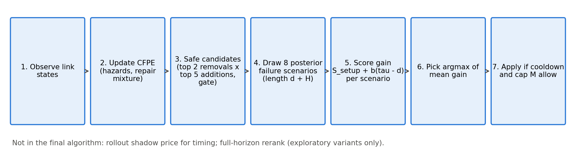

### 4.2. Causal failure posterior estimator (CFPE)

For each potential link the estimator tracks whether it failed, with a hazard that depends on the number N of its neighbouring links (sharing an endpoint) that were down in the previous epoch, bucketed as N = 0, 1, 2, 3+ with empirical-Bayes pooling across links and forgetting factor φ = 0.98. Down-times are modelled by a two-component geometric mixture fitted by expectation–maximisation {{R:Dempster1977}} on censored episodes; posterior draws of its parameters are obtained by the Bayesian bootstrap. A failure that coincides with many failed links at one node is attributed to the node rather than to individual links. The model is a *model*, not the truth: statements about it are statements about the estimator.

### 4.3. Scenario sampling

For each decision, S_sel = 8 failure scenarios of length d + H (H = 3 is the benefit window) are simulated forward from the current state, each with its own posterior parameter draw. Scenarios are generated from controller-owned random streams, independent of the environment's streams, so the controller cannot read the environment's future randomness. The same scenarios are shared by all candidates, so comparisons between candidates are paired.

### 4.4. Gain estimator and selection

The surrogate of E for a graph is obtained from the spectrum of the expected-weight matrix, Ê = 1 − min(1, −½ ln(Σ_{i≥2} λᵢ^{2T}/(n−1)) / ln(1/ε)). For a candidate a, the gain in scenario s is G_s(a) = S_setup + b·(τ − d), where S_setup is the improvement during the setup window, b the per-epoch improvement after the link becomes usable, and τ the remaining epochs. The controller selects

$$a^{*}=\arg\max_{a\in\mathcal A}\ \frac1{S_{\mathrm{sel}}}\sum_{s=1}^{S_{\mathrm{sel}}} G_s(a),\tag{2}$$

over the candidate set 𝒜 of the top K_r = 2 removals and K_a = 5 additions that pass the gate (up to 10 candidates). Candidates come from the shared candidate generator of the earlier controllers, and every one is filtered by the unchanged safety gate.

### 4.5. Timing and variants

COCRO-M spends a rewiring whenever the cooldown has elapsed and the cap M is not reached (the timing of the front-loaded schedule A7M), and uses eq. (2) only to choose *what* to swap. Table 2 lists the arms. The ablations remove one component each: a single removal candidate (k1), a Laplacian instead of the spectral surrogate (lap), a single scenario (s1), the posterior mean instead of posterior draws (plug), and no lagged-neighbour term (nb1). Two exploratory variants were developed and not adopted: a full-horizon rerank of a shortlist by simulated gain (mfg), and a rollout shadow-price rule that defers a rewiring when the expected value of waiting exceeds acting (cocro).

{{F:t_arms}}

### 4.6. Why rollout timing was tested and then dropped

A numerical study (exact dynamic programming against the rollout rule and an i.i.d. baseline in a correlated-failure toy world; `docs/COCRO_TOY_STUDY.md`) showed that deferral can pay off when failures are correlated: the rollout rule reached 99.2% of the exact optimum while the i.i.d. rule over-deferred. In the simulator, however, the pre-declared adoption rule (Section 5.3) evaluated on development seeds did not support adopting the rollout: its mean ΔE against selection-only COCRO-M was {{V:step2_roll_mean}} (mean z = {{V:step2_roll_z}}), far from the −0.010 threshold and from the z criterion. The final algorithm is therefore selection-only. The rollout base policy also ignores links still being set up, which biases it against acting when two or more rewirings remain; this limitation is documented and was not fixed.

### 4.7. Theoretical properties of the implementation

`docs/COCRO_THEORY.md` states seven propositions, each with a code location and a numerical test. (P1) Cap, cooldown, budget and tabu constraints hold in every run. (P2) A gate-accepted mutation does not increase the number of components in the final or interim graph at decision time; exogenous failures during setup can still disconnect the network. (P3) For constant symmetric doubly stochastic W and i.i.d. initial values, the expected mean-square contraction over T rounds is exactly (1/(n−1)) Σ_{i≥2} λᵢ^{2T}, and with random link outages it is bounded by λ₂(E[W²])^T {{R:BoydGossip2006}}; the surrogate in eq. (2) evaluates the metric's formula at the first quantity and is **not** a bound on E_k, because E_k uses a realised ratio inside a logarithm and is clipped. (P4) The sample-average selection is consistent as S_sel grows, with a Hoeffding bound on the probability of a wrong selection under the model. (P5) The per-decision cost is O(S (d+H) K n³). (P6) The one-step rollout is at least as good as its base policy in the model (an established result {{R:Bertsekas1997}}), which is not claimed for the simulator. (P7) The debt ledger of the earlier controller C1 is bounded under recoverable disturbances. Nothing in this section proves that COCRO-M lowers E_k; that is the empirical question of Section 6.

## 5. Experimental protocol

### 5.1. Conditions and arms

Three scenarios are crossed with two budgets: S1 (40-node random geometric graph, bursty failures), S2 (40 nodes, background failures) and S3 (80 nodes, bursty failures), each with M = 3 and M = 6, giving six conditions. The comparison arms and their frozen thresholds are those of the earlier studies and were not retuned: A0 (static), A1 (reactive threshold), A7 (front-loaded with a count distribution), A7M (exactly M front-loaded attempts), B8 (predictive, risk-filtered) and C1 (causal resilience debt). B8 was not calibrated for S2 with M = 6 and is therefore absent from that condition. All arms see identical failure traces within a seed.

### 5.2. Pre-registration and seeds

The protocol (`docs/PROTOCOL_R3.md`), the research questions, the primary comparisons, the statistics and the frozen configurations (56 files with a checksum manifest; `docs/R3_FREEZE.md`) were committed before the held-out run. Seed blocks do not overlap: consumed development seeds 8500–8519, ablation seeds 8520–8539, smoke seeds 8540–8559, and held-out Tier A seeds 9300–9449 (150 seeds). The held-out evaluation ran at commit {{V:commit_tier_A}}; the analysis script refuses to run on a modified source tree. The primary family has 17 tests: COCRO-M against A7M (6 conditions), B8 (5) and C1 (6). Statistics are paired per seed: Wilcoxon signed-rank tests with Holm correction within the family, 95% bootstrap intervals (10,000 resamples), standardised paired effect sizes, and two minimum practically meaningful margins, 0.01 (primary) and 0.02, on the difference in mean E.

### 5.3. Development-stage adoption rules

The choice between the rollout and the selection-only variants was fixed before the held-out run by a mechanical rule on the development ablation (seeds 8520–8539): a component was to be adopted only if all of the following held across the four development cells: the mean paired ΔE was at most a threshold (−0.010 for the rollout timing, −0.005 for the full-horizon rerank and the reservation variants), ΔE was non-positive in at least three of the four cells, and the mean of ΔE divided by its standard error was at most −1.5. Table 3 shows the outcome. No rule passed, so the simpler variant was kept and the final algorithm is `cocro_m` (final decision: {{V:step2_final}}).

Fig. 2 shows the same comparison graphically.

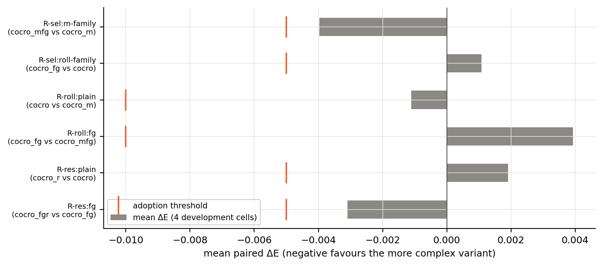

{{F:t_step2_cap}}

{{F:t_step2}}

### 5.4. What was and was not run

Tier A (the six random-geometric-graph conditions above) was run in full. Tier B (Erdős–Rényi, Barabási–Albert, Watts–Strogatz and scale-free graphs with 100 nodes) and Tier C (a cascade, node-failure and regime-shift failure model on 40-node graphs) were implemented, tested for inertness of the defaults and pre-registered, but **not run**: Tier B was started and then stopped by the authors before any output was read, and Tier C was not started. All claims below are therefore restricted to Tier A.

## 6. Results

### 6.1. Overall error

Table 4 gives mean E per arm and condition and Fig. 3 the corresponding intervals. COCRO-M had the lowest mean error among the non-exploratory arms in every condition.

{{F:t_means_cap}}

{{F:t_means}}

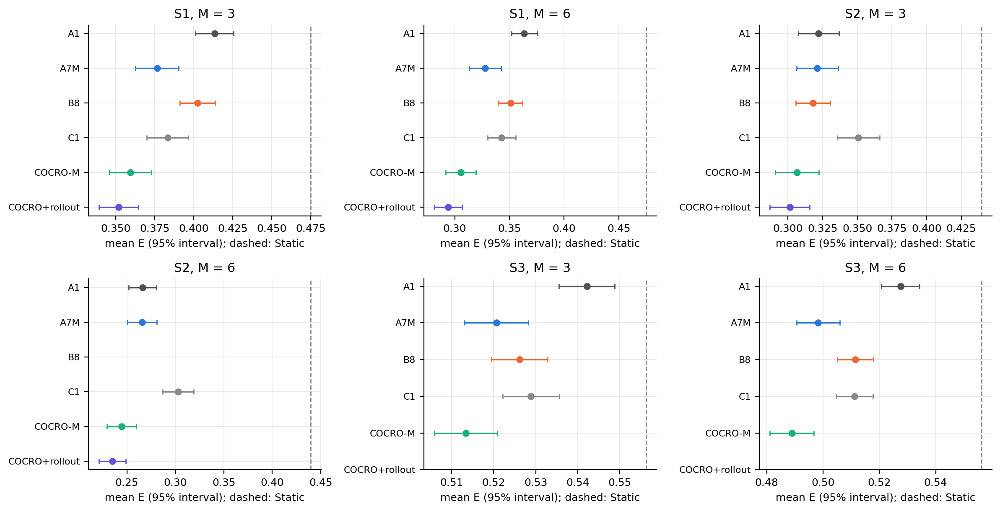

### 6.2. Primary comparisons

COCRO-M had lower mean error than the comparator in all {{V:n_primary}} primary tests (Holm p ≤ {{V:primary_max_holm}}). Against A7M the paired differences were {{V:rng_A7M}} (ΔE, COCRO-M minus comparator), against B8 {{V:rng_B8}} and against C1 {{V:rng_C1}}. Of the 17 differences, {{V:m001_all}} exceeded the 0.01 margin and {{V:m002_all}} the 0.02 margin. Against A7M the margin 0.01 was exceeded in {{V:m001_A7M}} of 6 conditions and the margin 0.02 in {{V:m002_A7M}}; in the two 80-node conditions the difference was statistically detectable but below the margin. Relative to A7M the reduction in mean E was {{V:rel_A7M}} ({{V:rel_A7M_s1s2}} in the 40-node conditions). Table 5 and Fig. 5 give the differences with intervals; Fig. 4 shows the per-seed distribution of the differences, which is wide: COCRO-M is lower on average, but not on every seed; the full test table (dz, both verdicts) is in Appendix A.

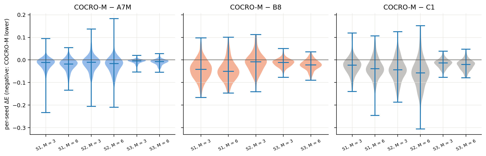

{{F:t_primary_cap}}

{{F:t_primary}}

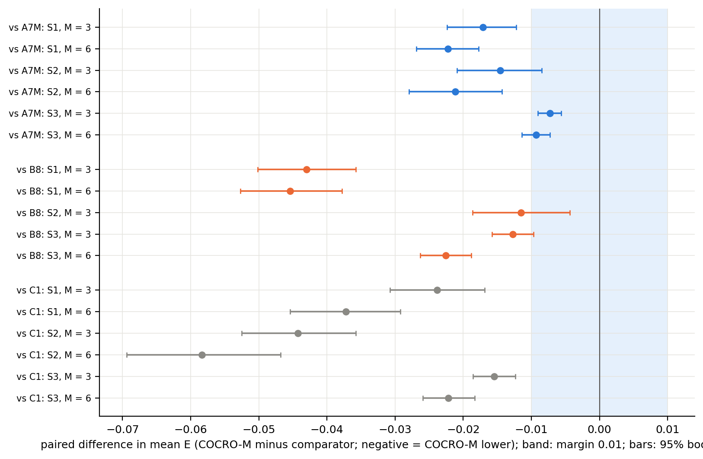

### 6.3. Component ablations

Table 6 gives the ablation differences relative to COCRO-M (positive: the ablated variant has higher error). Removing the multi-candidate removal set (k1) or replacing the spectral with the Laplacian surrogate (lap) increased error in {{V:abl_k1_worse}} and {{V:abl_lap_worse}} of 6 conditions respectively (Holm p < 0.05); the increase exceeded 0.01 in {{V:abl_k1_beyond}} and {{V:abl_lap_beyond}} conditions. Posterior sampling (plug) and the propagation term (nb1) showed no Holm-significant effect in any condition (ranges {{V:abl_plug_rng}} and {{V:abl_nb1_rng}}), and a single scenario (s1) a small, significant increase in {{V:abl_s1_sig}} conditions (range {{V:abl_s1_rng}}). The full-horizon rerank did not improve on COCRO-M ({{V:abl_mfg_rng}}; no significant effect). The data therefore support the candidate breadth and the spectral surrogate as useful components and do **not** support the propagation term or posterior sampling as measurably useful in this environment; they remain part of the model for generality, not for demonstrated benefit.

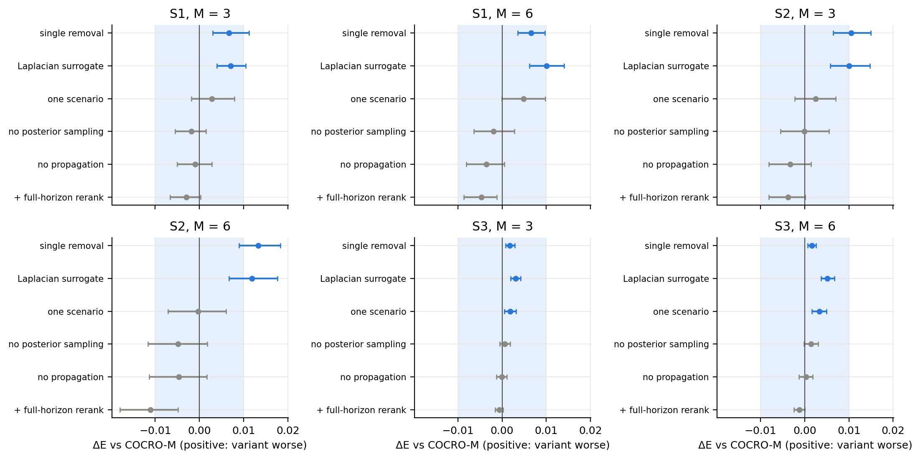

{{F:t_ablation_cap}}

{{F:t_ablation}}

### 6.4. Rollout timing (exploratory)

The rollout variant was run in S1 and S2 for cost reasons and is exploratory. Against COCRO-M its error difference ranged over {{V:roll_rng}} with {{V:roll_sig}} of 4 tests Holm-significant (smallest Holm p = {{V:roll_min_holm}}). It cost {{V:roll_cost_ratio}} times COCRO-M's decision time (Table 9). Given the development outcome in Section 5.3, the rollout is reported but not recommended.

### 6.5. Connectivity, recovery and overhead

COCRO-M's gains in error did not come with comparable gains in connectivity. Tables 7 and 8 give the disconnected share, longest disconnection, anchored recovery, worst-case E, overhead and realised mutations. COCRO-M had a slightly smaller disconnected share than A7M in {{V:disc_cocro_m_vs_A7M}} conditions, but the difference is small, and the predictive controller B8 had a smaller disconnected share and shorter recovery than COCRO-M in all five conditions in which it was run, at a higher error. The debt controller C1 and the rollout variant were also better than COCRO-M on disconnection or recovery in several conditions (see the tables). COCRO-M therefore resembles the front-loaded schedule in these measures and does not match the more conservative controllers. COCRO-M realised exactly M mutations in all conditions (budget utilisation 100%), whereas B8 and C1 left a small part of the budget unspent.

Figs. 7–9 show the same measures graphically.

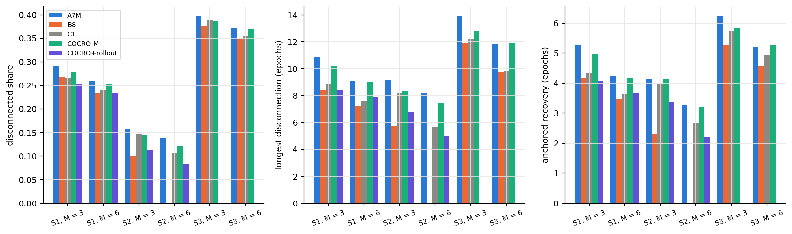

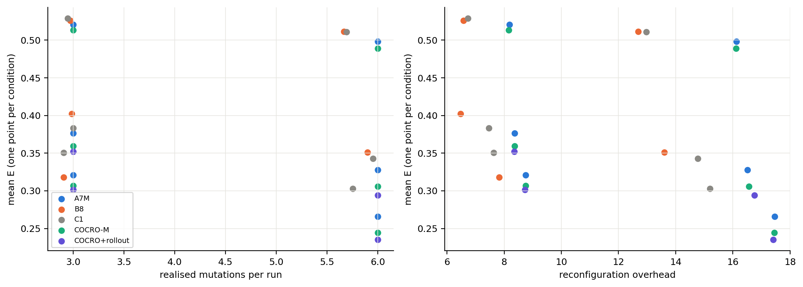

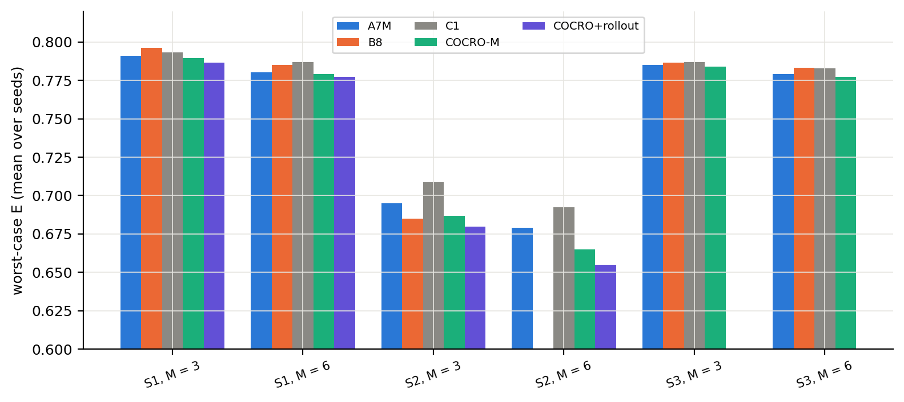

{{F:t_conn_m6_cap}}

{{F:t_conn_m6}}

{{F:t_conn_m3_cap}}

{{F:t_conn_m3}}

### 6.6. Cost and per-mutation efficiency

Table 9 reports decision time. COCRO-M's per-epoch decision time was {{V:cocro_m_vs_A7M_ms}} times that of A7M and below B8 and C1 in the conditions where those were run. Times were measured with parallel workers on one machine and under load, so they are indicative only. Table 10 gives the error reduction per mutation relative to Static; COCRO-M had the highest value in all six conditions. Fig. 10 shows the efficiency, Fig. 11 error against decision time and Fig. 12 decision time in all conditions.

{{F:t_cost_cap}}

{{F:t_cost}}

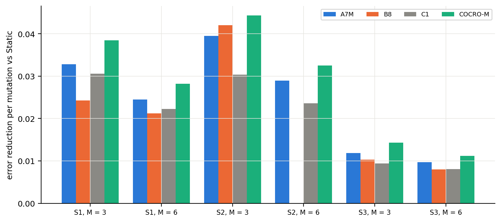

{{F:t_eff_cap}}

{{F:t_eff}}

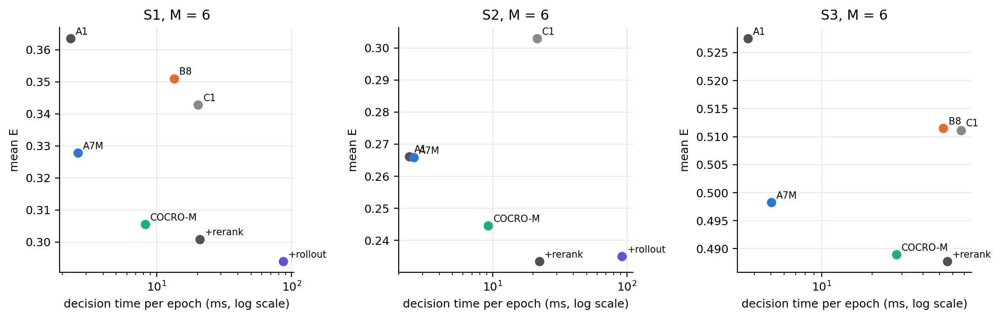

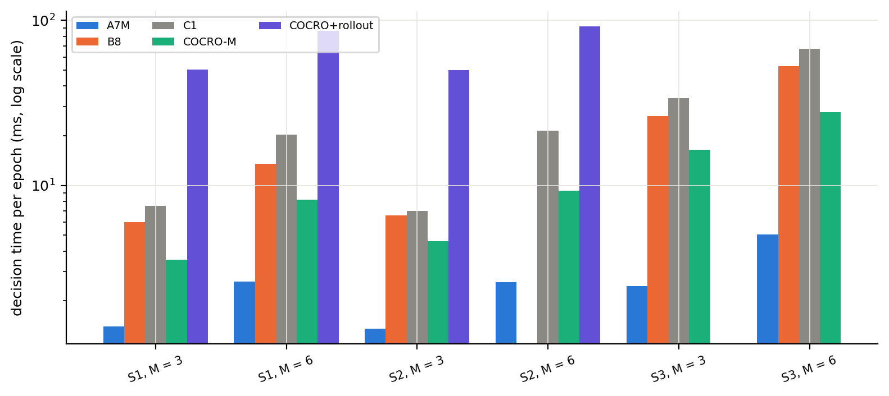

### 6.7. Earlier studies (context)

The earlier controllers were evaluated in v0.8 (60 held-out seeds) and Revision 2 (60 seeds, original and budget-matched calibrations). Table 11 summarises them. The predictive controller B8 beat the reactive controller A1 in all six conditions but not the front-loaded schedules; the debt controller C1 did not beat the front-loaded schedule A7 in any condition under budget-matched calibration. Those studies used the same conditions and metrics but different seeds and 60 rather than 150 seeds.

{{F:t_earlier_cap}}

{{F:t_earlier}}

## 7. Discussion

**What the evidence supports.** On the six random-geometric-graph conditions, with an algorithm and an analysis plan frozen in advance, selecting the swap by expected gain under posterior failure scenarios lowered the mean consensus error relative to three baselines at matched mutation budgets. The effects are small to moderate: against the strongest and cheapest baseline, the exact-budget front-loaded schedule, the reduction is {{V:rel_A7M}}, with a margin-exceeding effect in the four 40-node conditions only.

**What the ablations suggest about the mechanism.** The benefit appears to come from evaluating several removal candidates with a spectral objective rather than from the probabilistic machinery: the posterior-sampling and propagation components, which motivated the design, show no measurable benefit here. A plausible reading is that, in a random-geometric environment whose failure process is close to what the earlier controllers already summarised, the candidate ordering is robust to the failure-model details. This reading is untested; an environment with strong cascades, which Tier C would provide, is where the propagation term could matter.

**Timing.** The toy study shows a regime in which deferring a rewiring is valuable, but in the simulator the rollout timing gave at most small exploratory gains at about {{V:roll_cost_ratio}} times the cost, and the pre-declared rule dropped it. We interpret this as a negative result for state-dependent timing under a fixed budget in these environments, consistent with the earlier studies.

**Trade-offs.** COCRO-M uses the whole budget at the front-loaded times and therefore inherits the connectivity and recovery profile of the front-loaded schedule. If disconnection and recovery are the operational priority, B8 or C1 are preferable in several conditions despite their higher error.

## 8. Limitations

* **Tiers B and C were not run.** Only random geometric graphs with 40 and 80 nodes and the original burst/background failure models were tested. The performance on Erdős–Rényi, Barabási–Albert, Watts–Strogatz and scale-free graphs and under cascading, node and regime-shift failures is unknown. Tier B was started and stopped by the authors before any output was read.
* The propagation term, posterior sampling and the full-horizon rerank showed no measurable benefit in Tier A; their inclusion in the model is not justified by these data.
* Not implemented: delayed credit assignment, persistence-aware removal, per-link hazard models, the debt ledger inside COCRO, mobility, link-observation noise, scalability beyond 80 nodes and parameter-sensitivity grids.
* The thresholds of A1, B8 and C1 were calibrated on other seeds and under a different mutation-count rule; they are not tuned for the new seeds, which may disadvantage them. B8 is absent from S2 with M = 6.
* Decision times were measured with parallel workers under load. COCRO-M's absolute times are small, but the ratios are indicative.
* Connectivity and recovery gains over the front-loaded schedule are small, and B8 and C1 do better on several of these measures.
* The surrogate of E is biased upward (by 0.04–0.09 at mid-range) and saturates at the floor for small graphs; it orders candidates, it does not predict E. The consensus metric is evaluated with redrawn initial values and a fixed tolerance.
* The controller is centralised; no distributed or decentralised guarantee is claimed.
* The 150-seed minimum detectable effect is about 0.011 at 80% power for the observed paired SD; effects below the 0.01 margin are reported as such.
* The reference list was verified for existence and metadata against Crossref, not for the support of each individual statement.

## 9. Reproducibility

All results are produced by scripts from fixed configurations and seeds. The held-out run is `experiments/run_r3.py` (tier A), the analysis `experiments/analyze_r3.py`, and the manuscript tables and figures `paper/tools/make_v3_sections.py`; the claims of the text are checked against the analysis files by `paper/tools/check_claims_v3.py`. The test suite covers the failure model, scenario sampler, gain estimator, policy, environments, pipeline and the numerical checks of the theory note. The run used {{V:runs_tier_A}} runs on seeds 9300–9449 at commit {{V:commit_tier_A}}.

## 10. Conclusion

Under a hard cap on rewirings, choosing which link to swap by its expected gain under failure scenarios drawn from a fitted posterior lowered consensus error compared with the exact-budget front-loaded schedule, the predictive controller and the debt controller in all 17 primary tests of a pre-registered, 150-seed evaluation on random geometric graphs. The improvements are small to moderate, they come mainly from the candidate breadth and the spectral objective, rollout-based timing did not help, and connectivity and recovery are not better than those of more conservative controllers. The generality of the result to other graph families and failure processes remains to be tested; the corresponding evaluation is implemented and pre-registered but not run.

**Funding:** [AUTHOR CONFIRMATION REQUIRED: state the funding source(s), grant number(s), or “This research received no specific grant from any funding agency in the public, commercial, or not-for-profit sectors,” if accurate.]

**Declaration of competing interests:** [AUTHOR CONFIRMATION REQUIRED: confirm whether any financial or personal relationships could have influenced the work; use the target journal’s required wording. See also the Declaration of interests form at the end of the document.]

**CRediT authorship contribution statement:** [AUTHOR CONFIRMATION REQUIRED: assign each CRediT role to the appropriate author(s), with every author’s approval.]

**Ethics approval and consent:** Not applicable (simulation only; no human or animal data).

**Data availability statement:** The code, frozen configurations, analysis scripts, audit materials and analysis manifests are available at https://github.com/SanthoshAshish/TCCE-R/tree/revision-v0.8. Raw per-run evaluation logs are not included in the tracked repository; they may be made available by the authors on reasonable request or deposited in a suitable repository before submission, subject to the target journal’s policy. No DOI is currently assigned.

**Code availability:** Source code, experiment scripts and manuscript tools are available at https://github.com/SanthoshAshish/TCCE-R/tree/revision-v0.8. The Revision 3 held-out evaluation (Tier A) ran at commit {{V:commit_tier_A}}; the v0.8 held-out evaluation corresponds to commit e16a208, the Revision 2 original evaluation to commit d7f6a40 and the amended evaluation to commit 14b7359; the branch also contains the manuscript and analysis/audit updates.

**Declaration of generative AI and AI-assisted technologies in the manuscript preparation process:** The research design, experimentation, interpretation of results, and scientific conclusions presented in this manuscript were primarily carried out by the authors. Claude (Anthropic) was used as an assistive tool for selected tasks, including manuscript drafting, code development, and analysis scripting. The authors retained responsibility for the research methodology, evaluation of experimental results, interpretation of findings, and final manuscript content. All AI-assisted material was reviewed and edited by the authors, who take responsibility for the accuracy and integrity of the submitted work. All figures were generated programmatically from experimental result files, without the use of generative-AI image-generation tools.

**Acknowledgements:** The authors would like to express their sincere gratitude to Professor Deethi G for her valuable guidance, constructive feedback, and encouragement throughout this research. Her support and suggestions contributed to the development and refinement of this work. The authors also acknowledge their institution for providing an academic environment that supported this research.

## References

*<<REFSTATS>>. Reference metadata were checked against Crossref (existence, title, year); claims attached to citations are supported at the level of title and venue only. Holm (1979) has no DOI.*

<<REFERENCES>>

## Appendices

### Appendix A. Full primary test table

{{F:t_primary_detail_cap}}

{{F:t_primary_detail}}
